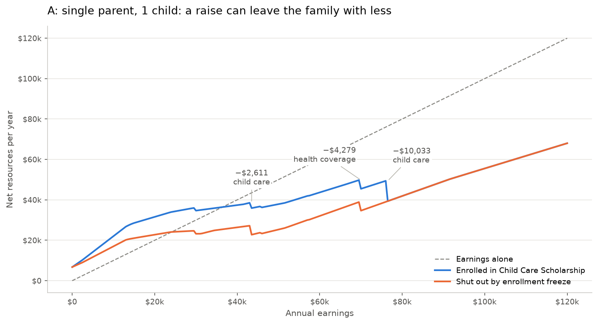
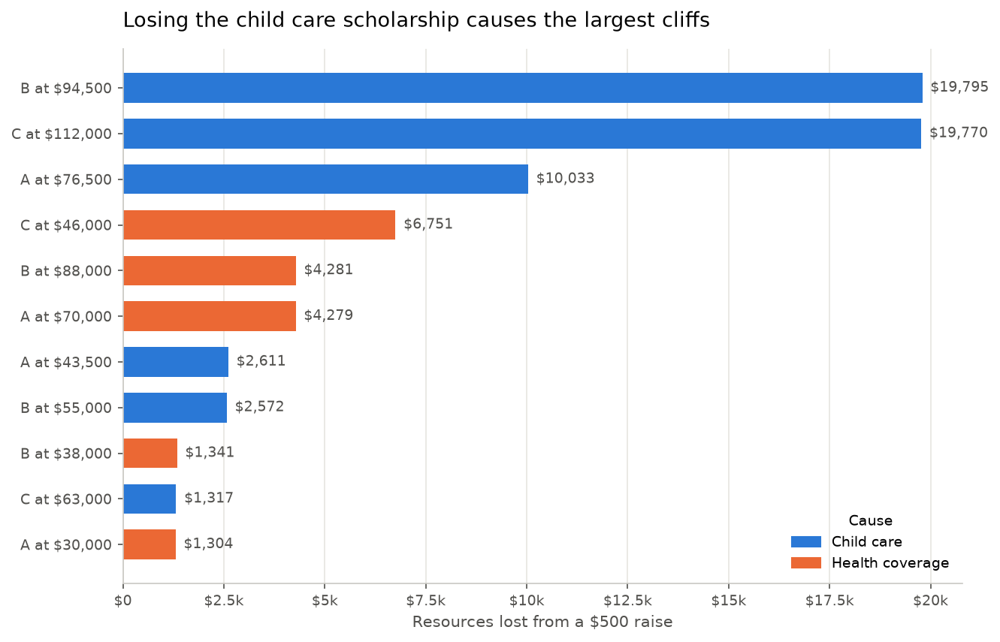

# Maryland Benefits Cliff Model

When a low-income family earns more, they can lose benefits faster than their pay goes up. I wanted to see exactly where that happens in Maryland, how much it costs families, and which programs cause it. So I built a model of the actual 2026 rules and ran it for three typical Baltimore City families at every earnings level from $0 to $120,000.

**[Try the calculator](https://maryland-benefits-cliff.streamlit.app/)** · **[Read the two-page policy memo](docs/policy_memo.pdf)**



## What I found

- **Losing child care help causes the biggest cliffs.** A single parent of two who goes from $94,000 to $94,500 loses about $19,800 a year when the Child Care Scholarship ends.
- **Some cliffs come from how programs connect.** Families on SNAP pay no child care copay, so when SNAP ends (around $43,500 for a single parent with one child), the copay starts at the same time.
- **Two-parent families lose the most from Medicaid.** At $46,000 both parents lose coverage at once, which costs about $6,750 to replace.
- **The child care enrollment freeze splits families in two.** A family shut out by the freeze has about $11,000 to $21,000 less a year than an enrolled family earning the same amount.



## How it works

For each family and earnings level, the model calculates:

**Net resources = earnings + SNAP + tax credits − taxes − child care paid − health coverage costs**

Then it finds every $500 step where net resources go *down*. That's a cliff. For each one, it reports how much the family loses and which program caused it.

| Program | File |
|---|---|
| SNAP | `cliff/snap.py` |
| Medicaid and MCHP | `cliff/medicaid.py` |
| Child Care Scholarship | `cliff/childcare.py` |
| Federal and Maryland taxes, EITC, Child Tax Credit | `cliff/taxes.py` |
| Putting it together, finding cliffs | `cliff/model.py` |
| Calculator | `app.py` (Streamlit) |

Every rule and dollar amount lives in one file, `params/maryland_2026.yaml`, with a source link next to each number. Nothing is hard-coded, so updating the model for 2027 means editing that one file.

There are 29 automated tests in `tests/`. Many of them check right at each program's income limit and one dollar past it, since that's where the cliffs are.

## Families modeled

| | Family | Children's ages |
|---|---|---|
| A | Single parent, one child | 3 |
| B | Single parent, two children | 3 and 7 |
| C | Two parents, two children | 3 and 7 |

Each family is run twice: already enrolled in the Child Care Scholarship, and shut out by the enrollment freeze that started in May 2025.

## Main assumptions

- Baltimore City, rules as of November 2026.
- The parent earns Maryland's $15 minimum wage, so child care needs grow with hours worked, up to full time at $31,200 a year.
- Lost health coverage is valued at what workers pay on average toward employer insurance (KFF 2025): $1,440 for one person, $6,850 for two or more.
- The full list, plus the questions I couldn't fully answer and how I handled them, is in [docs/requirements_doc.md](docs/requirements_doc.md).

## Limitations

- This is a simplified model. Real eligibility rules have more detail.
- The model uses the income limit for new child care applicants for every family. Enrolled families can usually keep the scholarship at higher incomes, so their real cliff may come later.
- The new child care copay tiers are approximated between the published lowest and highest amounts.
- Housing vouchers, WIC, TCA, and school meals aren't included.
- I compared the general pattern with the Atlanta Fed's CLIFF tool; differences come mostly from different assumptions about rent, child care prices, and health costs.

## Running it yourself

```bash
git clone https://github.com/swethasreemadan-2709/maryland-benefits-cliff.git
cd maryland-benefits-cliff
python3 -m venv .venv
source .venv/bin/activate
pip install -r requirements.txt

python -m pytest          # run the tests
python run_model.py       # create data/results.csv and data/cliffs.csv
python make_charts.py     # create the charts
streamlit run app.py      # open the calculator
```

To explore the notebooks, also run `pip install jupyter`.

## What I'd do next

- Add the real copay tiers and the continuing-eligibility income limit once they're published
- Add housing vouchers, WIC, and school meals
- Run it for other Maryland counties, and other states (only the parameters file would change)

## About

Built by Swetha Sree Madan · [LinkedIn](https://www.linkedin.com/in/swetha-sree-madan-mohan2709)

Personal project using only publicly available rules and data. It isn't affiliated with or endorsed by any Maryland state agency, and it isn't benefits or financial advice.